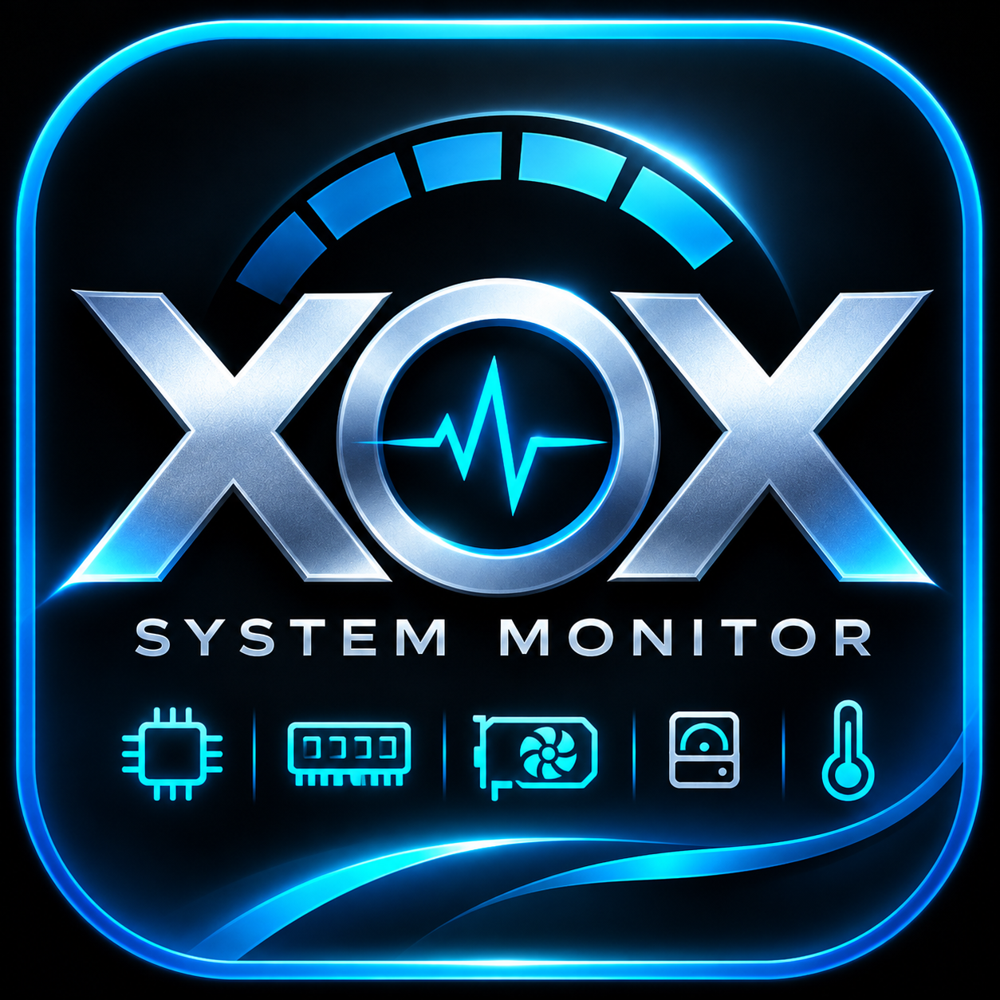
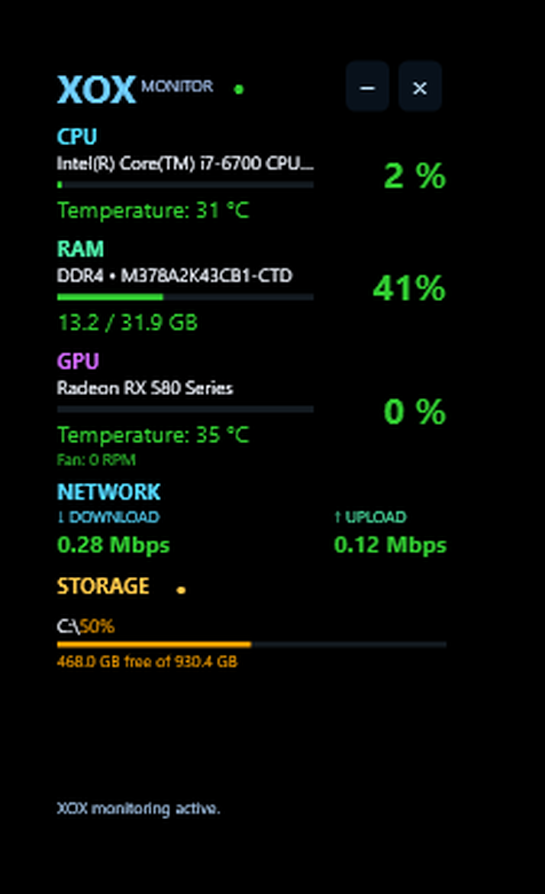

# XOX — Windows System Monitor

**A lightweight desktop widget for monitoring your PC.**

[Download XOX v1.0.0](https://github.com/alecmana/XOX/releases/download/v1.0.0/XOX-Setup.exe)

## Screenshot

## Features

- CPU usage and temperature
- RAM usage
- GPU usage and temperature
- Network download and upload speeds
- Storage monitoring
- Compact transparent desktop widget
- Always-on-top mode
- Full-screen and compact display modes

## Requirements

- Windows 10 or Windows 11 (64-bit)

## Installation

1. Download XOX-Setup.exe.
2. Run the installer.
3. Follow the installation prompts.
4. Launch XOX from the desktop or Start Menu.

## Updates

Check the [Releases page](https://github.com/alecmana/XOX/releases).

## License

Freeware. Free to download and use. All rights reserved.
